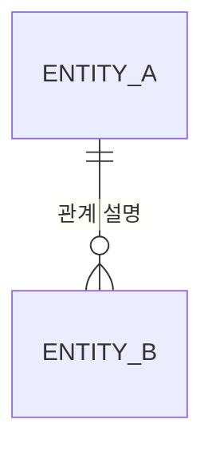

# ERD 작성 (docs/ERD.md)

ERD는 앱이 **어떤 자료를 어떤 이름으로 저장하는지** 정한다. 코드의 필드 이름, 화면의 표시 항목, 시험 데이터가 모두 여기를 따른다.

## 입력 (있는 것만, 이 순서로 읽는다)
1. `docs/PRD.md` — 요구사항(FR)이 읽고 쓰는 자료
2. `docs/IA.md` — 화면별 표시 항목·입력 항목
3. `docs/요구서/` — "다루는 자료 항목" 절
4. `docs/문제정의.md`, `GLOSSARY.md` — 용어. 엔터티 이름은 GLOSSARY 용어와 맞춘다
5. 현재 코드의 가짜 데이터·타입 정의

## 쓰는 규칙
1. 문서 맨 위에 `근거:`로 읽은 문서를 적는다.
2. Mermaid `erDiagram`으로 엔터티와 관계를 그린다.
3. 엔터티마다 필드 표를 둔다: `| 필드 | 타입 | 필수 | 설명 | 출처 |`. 출처 형식은 `[PRD FR-003]`, `[IA SCR-002 표시 항목]`.
4. 이름: 엔터티·필드는 영어 snake_case(코드와 같게), 설명은 한국어. GLOSSARY에 없는 새 용어가 필요하면 GLOSSARY에 먼저 올린다.
5. 계산으로 얻는 값(예: 다음 점검일)은 저장 필드인지 계산 값인지 표시한다. 정해지지 않았으면 "확인 필요".
6. **지어내지 않는다.** 근거 문서에 없는 필드는 만들지 않는다. 필요해 보이면 "확인 필요"와 질문 번호(Q번호)로 남기고 `docs/Intent.md` 5절에 올린다.
7. 로그인·저장소 같은 기술 결정이 아직이면 ERD에 그 사실을 적고 해당 필드를 확인 필요로 둔다.

## 템플릿
```md
# ERD: {프로젝트 이름}

근거: docs/PRD.md v{}, docs/IA.md v{}, GLOSSARY.md
- 최종 갱신: {YYYY-MM-DD} (v{버전})

## 관계도


## 엔터티
### {entity_name} — {한국어 이름}
| 필드 | 타입 | 필수 | 설명 | 출처 |
|---|---|---|---|---|

## 확인 필요
| # | 질문 | 막고 있는 필드 | 출처 |

## 변경 기록
| 날짜 | 버전 | 바뀐 내용 |
```

## 마무리 확인
- [ ] IA의 모든 표시·입력 항목이 어느 필드에 대응한다 (없으면 확인 필요에 올렸다)
- [ ] 모든 필드에 출처가 있다
- [ ] 엔터티 이름이 GLOSSARY 용어와 같다
- [ ] 저장 후 `harness-intent` 절차 B로 Intent 문서 지도와 변경 기록을 갱신했다
