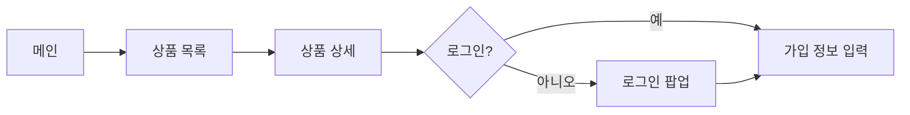

# 문서 유형별 작성 규칙과 템플릿

## 목차
1. IA (정보구조도)
2. 메뉴구조도
3. 화면목록
4. 공통 섹션 템플릿 (원본 스킬 계승)

---

## 1. IA (정보구조도)

**정의**: 웹/앱에 필요한 화면과 메뉴의 구조를 설계·정의하는 문서. 사용자가 목표 화면에 닿기까지의 흐름을 구조화해서 보여주고, 화면 간 연관성과 접근성을 업무 기준으로 분류한다.

**작성 규칙**
- **Depth**: 메인 = 0 Depth. 흐름을 따라 1, 2, 3 Depth로 내려간다. 최종 화면까지 빠짐없이 쓴다 (예: 회원가입 시작 → 약관 → 정보 입력 → 인증 → 완료 모두).
- Depth가 깊다 = 목표까지 단계가 많다. 얕게 유지하는 것을 권장하되, 필수 화면은 줄이지 않는다. 깊어지는 곳은 "왜 필요한지"를 비고에 남긴다.
- **형태**: 페이지 / 팝업 / 탭 / 링크 등으로 구분해 서비스 안에 어떤 형태의 화면이 있는지 드러낸다.
- **개발 구분**: 기능 개발이 필요한 화면과 단순 콘텐츠 화면을 나눈다. 일정·비용이 제한될 때 설계 우선순위를 정하는 근거가 된다.
- **그 외 분류**: 로그인 필요 여부, 추가/변경/삭제 상태, 파트별(기획·디자인·퍼블리싱·개발) 진행 현황 등 목적에 맞게 열을 추가한다.

**템플릿**
```markdown
# IA: [서비스명]
- 근거: docs/문제정의.md
- 작성일 / 버전:
- 범위: 신규 구축 | 리뉴얼
- Depth 한도: [예: 핵심 목표까지 3 Depth]

| 화면 ID | 0 Depth | 1 Depth | 2 Depth | 3 Depth | 화면명 | 형태 | 로그인 | 개발 구분 | 우선순위 | 상태 | URL | 비고 |
|---|---|---|---|---|---|---|---|---|---|---|---|---|
| HM_000000_PG | 메인 | | | | 메인 | 페이지 | 불필요 | 개발 | MVP | 신규 | / | |
```

화면 흐름 시각화가 필요하면 Mermaid flowchart로 함께 그린다:


---

## 2. 메뉴구조도

**정의**: 전체 메뉴와 서비스를 한눈에 볼 수 있도록 메뉴 구조를 시각화한 문서. IA와 달리 메뉴·서비스 단위로 쓰기 때문에 간결하다. 대형 사이트에서 GNB를 펼쳤을 때 보이는 사이트맵이 대표적 예.

**작성 규칙**
- 최종 진입 화면까지 쓰지 않는다. 서비스의 시작점까지만. 예: IA는 아이디/비밀번호 찾기의 시작~완료 모든 화면을 쓰지만, 메뉴구조도는 "아이디/비밀번호 찾기", "회원가입" 항목까지만.
- 보통 최대 3 Depth.
- **라벨**: 추가·변경·삭제 등 상태를 색상 라벨로 표시해 이해관계자의 이해를 돕는다. 라벨별로 시트를 나누기도 한다.
- 참고 대상이 필요하면 비슷한 서비스의 사이트맵을 먼저 본다.

**템플릿**
```markdown
# 메뉴구조도: [서비스명]
범례: 🟢 신규 · 🟡 변경 · 🔴 삭제 · (표시 없음) 유지

- 메인
  - 상품 🟢
    - 자동차보험
    - 여행자보험
  - 마이페이지
    - 가입 내역
    - 회원정보 수정 🟡
  - 고객센터
    - 공지사항
    - FAQ
  - 로그인
    - 회원가입
    - 아이디/비밀번호 찾기
```

---

## 3. 화면목록

**정의**: 서비스의 모든 화면을 목록으로 정리한 문서. 에이전시 등에서는 화면 ID 하나로 기획→디자인→퍼블리싱→개발이 진행되므로, 정보가 많은 IA 대신 경로와 ID만 있는 간결한 목록이 작업 효율을 높인다. 화면이 1,000개를 넘기도 하며 각 행이 작업 단위가 된다.

**작성 규칙**
- Depth는 IA 방식을 따르되, 열로 나누지 않고 **Location(경로, breadcrumb)** 한 열로 써도 충분하다. 핵심은 화면 ID와 화면명이 1:1로 맞는 것.
- 화면명·ID는 절대 중복되지 않는다.
- ID 규칙은 `screen-id-guide.md`.

**템플릿**
```markdown
| No | 화면 ID | 화면명 | Location | 형태 | 기획 | 디자인 | 퍼블 | 개발 |
|---|---|---|---|---|---|---|---|---|
| 1 | MY_010000_PG | 마이페이지 | 메인 > 마이페이지 | 페이지 | ☐ | ☐ | ☐ | ☐ |
```
1인 개발/바이브코딩이면 기획·디자인·퍼블·개발 열 대신 `구현 상태(대기/진행/완료)` 한 열로 줄인다.

---

## 4. 공통 섹션 템플릿 (원본 스킬 계승)

IA 문서 하단에 필요한 만큼 붙인다.

```markdown
## 확인된 사항
문제정의의 "확인 필요 목록" 중 인터뷰에서 답을 얻은 것. 가정으로 둔 것은 `(가정)` 표시.
| 항목 | 답 | 반영한 곳 |
|---|---|---|

## 네비게이션 모델
- 주 네비게이션(GNB/하단 탭): 항목과 최대 개수
- 보조 네비게이션(LNB/탭/사이드바)
- 유틸리티(계정, 설정, 도움말)
- 모바일 대응(햄버거, 하단 탭 등)

## 화면별 콘텐츠 우선순위
### [화면명]
1. [최우선 콘텐츠] — 이유
2. [두 번째] — 이유
3. [스크롤 아래 / 보조]

## 유저 플로우
### [플로우명] (예: 신규 가입, 보험 가입)
1. 사용자가 [화면]에 진입
2. [행동]
   - [조건 A]이면 → [결과]
   - [조건 B]이면 → [결과]
3. [도착 화면]

## 용어 정의
| 개념 | UI 표기 | 비고 |
|---|---|---|
| | | 한 개념엔 한 단어만 |

## 공통 컴포넌트
| 컴포넌트 | 사용 화면 | 차이점 |
|---|---|---|

## 콘텐츠 증가 대응
늘어나는 영역과 대응 방식(페이지네이션, 필터, 검색, 아카이브)

## URL 전략
- 패턴: /section/subsection/item-slug
- 동적 세그먼트 / 쿼리 파라미터 규칙
```
