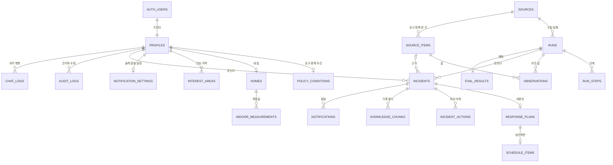

# ERD: HomeFit AI

근거: [docs/PRD.md](PRD.md) v1.0, [docs/IA.md](IA.md) v1.0, [docs/문제정의.md](문제정의.md)(사건 기준 표), [GLOSSARY.md](../GLOSSARY.md), [예외 경로](journeys/edge-cases/거절과-수집오류.md), [평가항목](프로젝트3-평가항목.md) P3-02·P3-08·P3-16·P3-21
- 최종 갱신: 2026-11-18 (v1.9, spec 009: wiki_chunks 미룸, chat_logs·llm_calls.purpose `wiki_answer`)
- 저장소: Supabase(PostgreSQL). 로그인은 Supabase Auth의 `auth.users`를 쓰고, 모든 사용자 표는 행 단위 권한(RLS)을 켠다.
- 범위: PRD Must(FR-01~27, 36, 37)에 필요한 표만. Should(FR-28~32)의 표는 2차 spec 때 더하고 변경 기록에 남긴다.

## 관계도

## 엔터티

### 사용자와 직접 입력

#### profiles — 회원
| 필드 | 타입 | 필수 | 설명 | 출처 |
|---|---|---|---|---|
| id | uuid (PK, = auth.users.id) | ✔ | 회원 ID | [PRD FR-01] |
| role | text: `user` / `admin` | ✔ | 기본 `user`. 관리자 화면 접근 판단 | [PRD FR-19] [IA AD_070000_PG] |
| display_name | text | | 화면에 보이는 이름. 관리자 화면에는 이름 대신 회원 ID를 보인다 | [IA 공통 컴포넌트 "사건 카드"] |
| created_at | timestamptz | ✔ | 가입 시각 | [PRD FR-01] |

#### policy_conditions — 공고·정책 조건
| 필드 | 타입 | 필수 | 설명 | 출처 |
|---|---|---|---|---|
| user_id | uuid (PK, FK profiles) | ✔ | 회원당 하나 | [PRD FR-02] |
| sido_code | text | ✔ | 시도 코드 | [IA MY_030100_TB] [문제정의 사건 기준] |
| sigungu_code | text | | 시군구 코드. 비면 시도 전체 | [IA MY_030100_TB] |
| supply_types | text[] | ✔ | 공급 유형. 기본값 "모두". 값 목록은 마이홈 응답 확인 뒤 정함 (Q6) | [PRD FR-02] [CUJ-01 명세 1단계] |
| max_monthly_rent | integer (원) | | 월 임대료 상한. 0 이상 | [PRD FR-02] |
| target_groups | text[]: `youth` / `newlywed` / `multichild` / `elderly` | ✔ | 대상(기본 빈 목록 = 모두). 공고 제목의 대상 낱말로 맞춤 공고를 거른다(v1.6, 마이그레이션 0013) | [PRD FR-02 v1.7] [GLOSSARY 대상] |
| age | integer | | 나이. 정책 조건 비교용 | [IA MY_030100_TB] |
| created_by | uuid | ✔ | 작성자 | [평가항목 P3-10] |
| updated_at | timestamptz | ✔ | 마지막 저장 시각 | [평가항목 P3-10] |

#### homes — 내 집
| 필드 | 타입 | 필수 | 설명 | 출처 |
|---|---|---|---|---|
| id | uuid (PK) | ✔ | | |
| user_id | uuid (FK profiles, 유일) | ✔ | 회원당 하나 | [GLOSSARY 내 집] |
| sigungu_code | text | ✔ | 시군구 코드. 상세 주소는 받지 않는다 | [PRD 8절 개인정보] |
| housing_type | text: `apartment` / `officetel` / `row_house` / `detached` | ✔ | 주택 유형. 실거래가 API 종류와 맞춤 | [PRD FR-03, FR-09] |
| exclusive_area_m2 | numeric | ✔ | 전용면적(㎡) | [PRD FR-03] |
| contract_type | text: `monthly` / `jeonse` | | 계약 형태(월세 / 전세) | [PRD FR-03] |
| deposit | integer (원) | | 보증금 | [PRD FR-03] |
| monthly_rent | integer (원) | | 월세. 전세면 0 | [PRD FR-03] |
| maintenance_fee | integer (원) | | 월 관리비. 월 예상 주거비 = 월세 + 관리비 (v1.5) | [PRD FR-03, FR-13 v1.6] [GLOSSARY 관리비] |
| contract_end_date | date | | 계약 만료일 | [PRD FR-03] |
| window_type | text: `single` / `double` / `unknown` | ✔ | 창 종류(홑유리 / 이중유리 / 모름) | [PRD FR-03] [CUJ-02 1단계] |
| created_by | uuid | ✔ | 작성자 | [평가항목 P3-10] |
| updated_at | timestamptz | ✔ | | [평가항목 P3-10] |

#### indoor_measurements — 측정값(실내 온습도)
| 필드 | 타입 | 필수 | 설명 | 출처 |
|---|---|---|---|---|
| id | uuid (PK) | ✔ | | |
| home_id | uuid (FK homes) | ✔ | | [PRD FR-04] |
| temperature_c | numeric | ✔ | 실내 온도. -10~45만 받음 | [PRD FR-04] |
| humidity_pct | numeric | ✔ | 실내 습도. 0~100만 받음 | [PRD FR-04] |
| measured_at | timestamptz | ✔ | 측정 시각. 몇 시간 지난 값까지 쓸지는 Q4 | [PRD FR-04] [GLOSSARY 측정값] |
| created_by | uuid | ✔ | 작성자 | [평가항목 P3-10] |
| created_at | timestamptz | ✔ | 입력 시각 | [평가항목 P3-10] |

#### interest_areas — 관심 지역
| 필드 | 타입 | 필수 | 설명 | 출처 |
|---|---|---|---|---|
| id | uuid (PK) | ✔ | 회원당 여러 개 | [PRD FR-05] |
| user_id | uuid (FK profiles) | ✔ | | [PRD FR-05] |
| sigungu_code | text | ✔ | | [GLOSSARY 관심 지역] |
| housing_type | text (homes와 같은 값) | ✔ | | [GLOSSARY 관심 지역] |
| target_area_m2 | numeric | ✔ | 기준 면적. ±20%로 비교 | [문제정의 사건 기준 표] |
| contract_type | text: `monthly` / `jeonse` | ✔ | | [GLOSSARY 관심 지역] |
| last_median_value | integer (원) | | 지난번 본 **월세** 중간값(월세 계약만). 시세(관심 지역) 사건 비교 기준 (저장 값, v1.8에 뜻을 좁힘) | [문제정의 사건 기준 표 (나)] |
| last_median_deposit | bigint (원) | | 지난번 본 **보증금** 중간값 (v1.8) | [spec 008 Q2] 사용자 결정 2026-11-18 "월세·보증금 둘 다" |
| created_by | uuid | ✔ | | [평가항목 P3-10] |
| created_at | timestamptz | ✔ | | [평가항목 P3-10] |

#### notification_settings — 슬랙 알림 설정
| 필드 | 타입 | 필수 | 설명 | 출처 |
|---|---|---|---|---|
| user_id | uuid (PK, FK profiles) | ✔ | 한 사람에 하나 | [PRD FR-37] |
| slack_email | text | | 팀 슬랙 워크스페이스에서 쓰는 이메일. 개인 정보라 본인만 읽고 관리자도 읽지 못한다 | [PRD FR-37] [IA MY_030500_TB] |
| slack_user_id | text | | 봇이 이메일로 찾은 슬랙 사람 ID. DM을 보낼 곳. 이메일을 바꾸면 다시 찾는다 | [PRD FR-37] |
| enabled | boolean | ✔ | 기본 false. 켜는 것이 알림 승인. 슬랙 사람 ID가 없으면 켤 수 없다 | [PRD FR-37, 8절] |
| enabled_at | timestamptz | | 마지막으로 켠 시각(알림 승인 시각) | [PRD 8절] |
| updated_at | timestamptz | ✔ | | [PRD FR-37] |

### 수집

#### sources — 수집 출처
| 필드 | 타입 | 필수 | 설명 | 출처 |
|---|---|---|---|---|
| code | text (PK) | ✔ | `myhome_notice`, `youth_policy`, `kma_forecast`, `molit_rent_apartment`, `molit_rent_officetel`, `molit_rent_row_house`, `molit_rent_detached` | [PRD FR-06~09] |
| name | text | ✔ | 화면 표시 이름 | [IA AD_070200_TB] |
| schedule | text | ✔ | 간격 설명(하루 1번 등). 실제 예약은 정기 실행 설정에 둔다 | [PRD FR-06~09] |
| enabled | boolean | ✔ | 끄면 정기 실행에서 빠짐 | [IA AD_070200_TB] (확인 필요: 관리자가 끌 수 있어야 하는가, Q7) |

#### runs — 실행 기록
| 필드 | 타입 | 필수 | 설명 | 출처 |
|---|---|---|---|---|
| id | uuid (PK) | ✔ | | [평가항목 P3-08] |
| source_code | text (FK sources) | ✔ | | [PRD FR-21] |
| trigger | text: `scheduled` / `manual` / `simulation` | ✔ | 시작 노드 3종(정기 실행 / 지금 한 번 실행 / 시뮬레이터) | [평가항목 P3-08] [PRD FR-21, FR-24] |
| triggered_by | uuid (FK profiles) | | 사람이 눌렀으면 그 관리자 | [PRD FR-21] |
| status | text: `running` / `succeeded` / `failed` | ✔ | 실패는 "수집 오류". "변화 없음"과 다름 | [PRD FR-06] [예외 경로 E2] |
| error_message | text | | 오류 내용. 키·토큰은 가린 뒤 저장 | [PRD FR-21, FR-27] |
| started_at | timestamptz | ✔ | | [평가항목 P3-17] |
| finished_at | timestamptz | | | [평가항목 P3-17] |

연속 실패 수는 저장하지 않고 같은 출처의 최근 `runs`에서 계산한다(계산 값).

#### run_steps — 실행 단계
| 필드 | 타입 | 필수 | 설명 | 출처 |
|---|---|---|---|---|
| id | uuid (PK) | ✔ | | [평가항목 P3-08] |
| run_id | uuid (FK runs) | ✔ | | [평가항목 P3-08] |
| step_order | integer | ✔ | 흐름 화면에서 상자 순서 | [PRD FR-23] |
| step_name | text: `collect` / `compare` / `detect` / `draft_plan` / `notify` / `await_approval` / `record` | ✔ | 수집 → 비교 → 사건 판단 → 대응안 초안 → 알림 → 승인 대기 → 기록. `notify`는 보낸·실패한 알림 수 | [IA 핵심 흐름] [PRD FR-23] |
| status | text: `succeeded` / `failed` / `waiting` / `skipped` | ✔ | `waiting`은 승인 대기(주황 점선) | [CLAUDE.md 디자인 "흐름 화면 상태 색"] |
| items_in | integer | | 들어온 건수 | [PRD FR-23 "분기 건수"] |
| items_out | integer | | 다음 단계로 간 건수 | [PRD FR-23 "분기 건수"] |
| detail | jsonb | | 상자 상세(입력·출력 요약). 키는 가림 | [IA AD_070401_MD] |
| started_at, finished_at | timestamptz | | | [IA AD_070401_MD] |

#### source_items — 공고·정책 한 건
| 필드 | 타입 | 필수 | 설명 | 출처 |
|---|---|---|---|---|
| id | uuid (PK) | ✔ | | |
| source_code | text (FK sources) | ✔ | `myhome_notice` / `youth_policy` | [PRD FR-06, FR-07] |
| external_id | text | ✔ | 공고 ID / 정책 ID. (source_code, external_id) 유일 → 중복 사건 방지 | [PRD FR-10] [문제정의 중복 기준] |
| title | text | ✔ | 공고·정책 이름 | [IA IC_020100_PG] |
| sido_code, sigungu_code | text | | 지역 | [PRD FR-10] |
| supply_type | text | | 공급 유형 (Q6) | [PRD FR-10] |
| monthly_rent | integer | | 월 임대료 (Q6) | [PRD FR-10] |
| announced_at | date | | 공고일. 대표 KPI의 시작점 | [PRD 3절 KPI] |
| apply_start, apply_end | date | | 신청 기간 | [PRD FR-15] |
| url | text | | 원문 공고 링크 | [CUJ-01 명세 3단계] |
| content_hash | text | ✔ | 접수 기간·월 임대료·공급 유형이 바뀌었는지 비교용 | [PRD FR-10] |
| complex_key | text | | 같은 단지를 알아보는 값. 마이홈 `hsmpNm`(단지 이름) + 시군구 코드 | [PRD FR-10] |
| status_name | text | | 공고 상태. 마이홈 `sttusNm`(예: "정정공고") | [PRD FR-10] |
| before_external_id | text | | 고치기 전 공고 ID. 마이홈 `beforePblancId`. 이미 본 공고를 가리키면 정정 사건 | [PRD FR-10] |
| previous_values | jsonb | | 바로 앞 수집 때의 접수 기간·월 임대료·공급 유형. 사건 상세의 "전 → 후" | [PRD FR-10] |
| raw | jsonb | ✔ | 원본 응답 | [ERD 결정 2] |
| first_seen_at, last_seen_at | timestamptz | ✔ | | [PRD FR-10] |

응답 칸이 실제로 있는지는 샘플 확인 전이다(문제정의 확인 필요 2·6, Q6).

#### observations — 모은 값 (같은 모양)
| 필드 | 타입 | 필수 | 설명 | 출처 |
|---|---|---|---|---|
| id | uuid (PK) | ✔ | | |
| run_id | uuid (FK runs) | ✔ | | [평가항목 P3-02] |
| source_code | text (FK sources) | ✔ | 출처 | [평가항목 P3-02] |
| observed_at | timestamptz | ✔ | 시각(예보면 예보 대상 시각) | [평가항목 P3-02] |
| target | text | ✔ | 대상(시군구 코드, 예보 격자, 공고 ID 등) | [평가항목 P3-02] |
| metric | text | ✔ | 지표(`temperature`, `humidity`, `median_rent`, `notice` 등) | [평가항목 P3-02] |
| value_numeric | numeric | | 값(숫자) | [평가항목 P3-02] |
| value_text | text | | 값(글자) | [평가항목 P3-02] |
| change_amount | numeric | | 바뀐 정도(지난 값 대비) | [평가항목 P3-02] |
| source_item_id | uuid (FK source_items) | | 공고·정책이면 연결 | [ERD 결정 2] |
| raw | jsonb | | 원본 일부 | [ERD 결정 2] |
| is_simulated | boolean | ✔ | 시뮬레이터 자료 표시 | [PRD FR-24] [평가항목 P3-33 "실수집/가상 표시"] |

### 사건과 대응

#### incidents — 사건
| 필드 | 타입 | 필수 | 설명 | 출처 |
|---|---|---|---|---|
| id | uuid (PK) | ✔ | | [PRD FR-10~12] |
| user_id | uuid (FK profiles) | ✔ | 받는 사람 | [PRD FR-10] |
| incident_type | text: `housing_support` / `humidity_condensation` / `rent_price_change` | ✔ | 사건 종류(청년 주거 지원 공고·정책 / 습도·결로 위험 / 주변 전월세 시세 변화) | [GLOSSARY 사건 종류] |
| target_kind | text: `condition` / `home` / `interest_area` | ✔ | 무엇을 기준으로 생긴 사건인가 | [문제정의 사건 기준 표] |
| target_id | uuid | | homes.id 또는 interest_areas.id | [문제정의 중복 기준] |
| source_item_id | uuid (FK source_items) | | 공고·정책 사건의 근거 | [PRD FR-10] |
| run_id | uuid (FK runs) | ✔ | 만든 실행 | [PRD FR-23] |
| dedup_key | text | ✔ | (user_id, dedup_key) 유일. 공고: 공고 ID + 바뀐 뒤 content_hash(같은 변화는 한 번) 또는 재공고 공고 ID / 습도: 집 + 48시간 구간 / 시세: 대상 + 연월 | [PRD FR-10~12] [문제정의 중복 기준] |
| status | text: `new` / `pending` / `approved` / `rejected` | ✔ | 새 사건 → 승인 대기 → 승인·거절 | [IA 공통 컴포넌트 "상태 배지"] |
| facts | jsonb | ✔ | 바뀐 것: 원문 값, 공고면 바뀐 칸과 전 → 후 값·변화 종류(기간·임대료·공급 유형·완화 재공고), 측정값·추정값(이슬점, 표면 온도, 중간값, 거래 수), 출처, 수집 시각 | [PRD FR-15] [GLOSSARY 측정값·추정값] |
| is_updated | boolean | ✔ | v1.0의 "기존 사건 갱신" 표시. v1.1부터 공고 변화는 새 사건이라 새 행은 false. 지난 행 때문에 남김 | [CUJ-01 명세 E5] |
| is_simulated | boolean | ✔ | 시뮬레이터 사건 | [PRD FR-24] |
| detected_at | timestamptz | ✔ | 사건 생성 시각 | [PRD FR-10] |
| first_viewed_at | timestamptz | | 사용자가 상세를 처음 연 시각. 대표 KPI의 끝점 | [PRD 3절 KPI] |
| closed_at | timestamptz | | 승인·거절로 끝난 시각. 끝나면 기록 찾기 대상 | [PRD FR-18] |

#### response_plans — 대응안
| 필드 | 타입 | 필수 | 설명 | 출처 |
|---|---|---|---|---|
| id | uuid (PK) | ✔ | | |
| incident_id | uuid (FK incidents, 유일) | ✔ | 사건당 하나 | [PRD FR-15] |
| plan_type | text: `application_prep` / `response_plan` / `renewal_memo` / `interest_home_review` | ✔ | 신청 준비 계획 / 대응 계획 / 재계약 판단 메모 / 관심 주택 다시 보기 | [GLOSSARY] [문제정의 사건 기준 표] |
| ai_summary | text | | AI 요약. 실패하면 비어 있음 | [PRD FR-15] |
| checklist | jsonb | ✔ | 할 일 목록(항목, 기한). AI 실패 때는 코드가 만든 기본 목록 | [CUJ-01 명세 3·5단계] |
| citations | jsonb | ✔ | 출처(원문 링크, 수집 값, 비슷한 지난 사건) | [PRD FR-15, FR-18] |
| generation_status | text: `succeeded` / `failed` | ✔ | AI 요약 실패 표시 | [CUJ-01 명세 E4] |
| model | text | | 쓴 모델 이름 | [평가항목 P3-18] |
| created_at | timestamptz | ✔ | | |

#### incident_actions — 처리 이력
| 필드 | 타입 | 필수 | 설명 | 출처 |
|---|---|---|---|---|
| id | uuid (PK) | ✔ | 지우거나 고치지 않는다(쌓기만) | [평가항목 P3-04, P3-13] |
| incident_id | uuid (FK incidents) | ✔ | | [PRD FR-16, FR-17] |
| actor_id | uuid (FK profiles) | ✔ | 한 사람 | [PRD FR-16, FR-17] |
| action | text: `approve` / `reject` | ✔ | 관리자 수정은 audit_logs에 따로 | [PRD FR-16, FR-17, FR-22] |
| reason | text | | 거절이면 필수 | [PRD FR-17] |
| created_at | timestamptz | ✔ | 시각 | [PRD FR-16, FR-17] |

#### schedule_items — 내 일정
| 필드 | 타입 | 필수 | 설명 | 출처 |
|---|---|---|---|---|
| id | uuid (PK) | ✔ | | [IA SC_060000_PG] |
| user_id | uuid (FK profiles) | ✔ | | [PRD FR-16] |
| response_plan_id | uuid (FK response_plans, 유일) | | 두 번 승인해도 일정 하나. 알림에서 온 일정만 (v1.7) | [PRD FR-16] |
| incident_id | uuid (FK incidents) | | 출처 사건 링크. 알림에서 온 일정만 (v1.7) | [IA SC_060100_PG] |
| source_code | text (FK sources) | | 공고에서 온 일정의 출처 `myhome_notice` (v1.7) | [PRD FR-16 v1.9] [spec 007] |
| announcement_id | text | | 공고에서 온 일정의 공고 ID. (user_id, source_code, announcement_id) 유일 → 두 번 눌러도 하나 (v1.7) | [spec 007 FR-002] |
| title | text | ✔ | | [IA SC_060000_PG] |
| due_date | date | | 마감일. 지나면 "마감 지남" (계산 표시) | [PRD FR-16] |
| checklist_state | jsonb | ✔ | 항목별 완료 여부 | [PRD FR-16] |
| created_at, updated_at | timestamptz | ✔ | | |

### 기록 찾기, 관리자, 위키 챗봇, 채점

#### knowledge_chunks — 기록 찾기 자료
| 필드 | 타입 | 필수 | 설명 | 출처 |
|---|---|---|---|---|
| id | uuid (PK) | ✔ | | [PRD FR-18] |
| user_id | uuid (FK profiles) | ✔ | 내 기록만 찾음 | [PRD FR-18] [평가항목 P3-14] |
| incident_id | uuid (FK incidents) | ✔ | 끝난 사건(closed_at 있음)만 | [PRD FR-18] |
| content | text | ✔ | 사건 요약 + 처리 결과 + 사유 | [PRD FR-18] |
| embedding | vector(확인 필요) | ✔ | pgvector. 차원과 임베딩 모델은 Q1 | [CLAUDE.md 스택] |
| created_at | timestamptz | ✔ | | |

#### audit_logs — 관리자 수정 기록
| 필드 | 타입 | 필수 | 설명 | 출처 |
|---|---|---|---|---|
| id | uuid (PK) | ✔ | 쌓기만 | [평가항목 P3-13] |
| actor_id | uuid (FK profiles) | ✔ | 담당자 | [PRD FR-20] |
| target_table | text | ✔ | 고친 표 | [PRD FR-20] |
| target_id | uuid | ✔ | 고친 행 | [PRD FR-20] |
| before, after | jsonb | ✔ | 고치기 전·후 | [PRD FR-20] |
| reason | text | ✔ | 사유 | [PRD FR-20] |
| created_at | timestamptz | ✔ | 시각 | [PRD FR-20] |

#### wiki_chunks — 위키 쪽 조각
> **미룸 (v1.9, spec 009 Q3, 사용자 결정 2026-11-18)**: 위키 챗봇은 배포 묶음 안의 `wiki/` 파일을 바로 읽어 낱말로 찾는다. 이 표는 만들지 않았고, 임베딩이 필요해지면 다시 정한다.

| 필드 | 타입 | 필수 | 설명 | 출처 |
|---|---|---|---|---|
| id | uuid (PK) | ✔ | 원본은 저장소 `wiki/` 파일. 여기는 찾기용 복사본 | [CLAUDE.md 팀 작업 규칙 "위키"] |
| page_path | text | ✔ | 위키 파일 경로(출처 표시) | [PRD FR-26] |
| heading | text | | 절 제목 | [PRD FR-26] |
| content | text | ✔ | | [PRD FR-26] |
| embedding | vector(확인 필요) | ✔ | Q1 | [PRD FR-26] |
| updated_at | timestamptz | ✔ | 위키 반영 시각 | [평가항목 P3-20] |

#### chat_logs — 위키 챗봇 기록
| 필드 | 타입 | 필수 | 설명 | 출처 |
|---|---|---|---|---|
| id | uuid (PK) | ✔ | | [평가항목 P3-21] |
| user_id | uuid (FK profiles) | ✔ | 물은 관리자 | [평가항목 P3-21] |
| question | text | ✔ | 1~300자 (0018) | [PRD FR-26] [spec 009 FR-014] |
| answer | text | ✔ | 근거가 없으면 "위키에 없습니다". 600자 이내 (0018) | [PRD FR-26] [spec 009 Q1] |
| cited_pages | jsonb | ✔ | 출처 위키 쪽 목록(비면 위키에 없음) | [PRD FR-26] |
| created_at | timestamptz | ✔ | 하루 질문 수는 이 칸으로 계산(계산 값) | [PRD FR-26] |

#### eval_results — 채점 결과
| 필드 | 타입 | 필수 | 설명 | 출처 |
|---|---|---|---|---|
| id | uuid (PK) | ✔ | | [PRD FR-25] |
| run_id | uuid (FK runs) | ✔ | 시뮬레이터 실행 | [PRD FR-25] |
| dataset_name | text | ✔ | 정답 묶음 이름. 묶음 파일은 `sim/`·`eval/` 폴더에 둔다(DB 아님) | [CLAUDE.md 폴더] |
| true_positive | integer | ✔ | 맞힌 수 | [평가항목 P3-06] |
| false_negative | integer | ✔ | 놓친 수 | [평가항목 P3-06] |
| false_positive | integer | ✔ | 잘못 울린 수 | [평가항목 P3-06] |
| duplicate_count | integer | ✔ | 중복 사건 수(KPI 3) | [PRD 3절 KPI] |
| created_at | timestamptz | ✔ | | |

#### notice_follows — 공고 팔로우 (H-006)
| 필드 | 타입 | 필수 | 설명 | 출처 |
|---|---|---|---|---|
| user_id | uuid (FK profiles) | ✔ | (user_id, source_code, announcement_id) 유일 | [PRD FR-38] |
| source_code | text (FK sources) | ✔ | `myhome_notice` | [PRD FR-38] |
| announcement_id | text | ✔ | 공고 ID(단지 여럿을 묶음) | [PRD FR-38] |
| decision | text: `follow` / `ignore` | ✔ | 승인(팔로우) / 거절(관심 없음) | [PRD FR-38] |
| reason | text | | 거절 사유(선택) | [PRD FR-38] |
| decided_at | timestamptz | ✔ | 결정한 시각. 팔로우 전에 생긴 변화는 사건으로 만들지 않는 기준 | [PRD FR-38] |

#### notice_summaries — 공고 요약 (H-006)
| 필드 | 타입 | 필수 | 설명 | 출처 |
|---|---|---|---|---|
| source_code, announcement_id | text (PK 둘) | ✔ | 공고마다 한 줄. 모든 사용자가 같이 읽음(공개 자료) | [PRD FR-38] |
| summary | text | ✔ | AI 공고 요약 | [PRD FR-38] |
| model | text | ✔ | `공급자:모델` | [spec 002 FR-010] |
| created_at | timestamptz | ✔ | | |

#### notifications — 알림 기록
| 필드 | 타입 | 필수 | 설명 | 출처 |
|---|---|---|---|---|
| id | uuid (PK) | ✔ | | [PRD FR-37] |
| incident_id | uuid (FK incidents) | ✔ | (incident_id, channel) 유일 → 같은 사건은 한 번만 보냄 | [PRD FR-37] |
| user_id | uuid (FK profiles) | ✔ | | [PRD FR-37] |
| channel | text: `slack` | ✔ | | [PRD FR-37] |
| status | text: `sent` / `failed` | ✔ | | [PRD FR-37] |
| attempts | integer | ✔ | 보낸 횟수. 실패는 다음 수집에 한 번 더(최대 2) | [PRD FR-37] |
| last_error | text | | 실패 이유. 봇 토큰·이메일은 가린 뒤 저장 | [PRD FR-37, FR-27] |
| sent_at | timestamptz | | 보낸 시각 | [PRD FR-37] |
| created_at | timestamptz | ✔ | | |

#### llm_calls — AI 호출 기록 (spec 002)
| 필드 | 타입 | 필수 | 설명 | 출처 |
|---|---|---|---|---|
| id | uuid (PK) | ✔ | | [spec 002 FR-004] |
| run_id | uuid (FK runs) | | 어느 수집 실행에서 불렀나. 수집 밖(시험 메시지 등)이면 비움 | [spec 002 FR-004] |
| provider | text: `gemini` / `claude` / `mock` | ✔ | 공급자. 나중에 `groq`·`openrouter`를 더할 수 있다 | [spec 002 FR-001] |
| model | text | | 모델 이름. 설정이 없어 부르지 못했으면 비움 | [spec 002 FR-004] |
| purpose | text: `application_plan` / `notice_summary` / `response_plan` / `chat_answer` / `wiki_answer` | ✔ | 용도(신청 준비 계획 / 공고 요약, v1.4 / 습도·결로 대응 계획, 마이그레이션 0011 / 챗봇 답 0014 / 위키 챗봇 답 0018) | [spec 002 FR-004] [spec 003 FR-007] |
| ok | boolean | ✔ | 성공 여부 | [spec 002 FR-004] |
| error_kind | text: `config` / `auth` / `rate_limit` / `timeout` / `refused` / `invalid_json` / `invalid_shape` / `server` / `unknown` | | 실패 종류(성공이면 비움) | [spec 002 FR-002] |
| attempts | integer | ✔ | 시도 횟수(한도 초과로 다시 시도한 것 포함) | [spec 002 FR-005] |
| latency_ms | integer | ✔ | 처음 부른 때부터 끝날 때까지(기다린 시간 포함) | [spec 002 FR-004] |
| input_tokens, output_tokens | integer | | 공급자가 알려 준 토큰 수. 모르면 비움 | [spec 002 FR-004] |
| created_at | timestamptz | ✔ | | |

보낸 글·받은 글·키는 저장하지 않는다(spec 002 FR-004, FR-008). 오류 설명은 실행 기록에 가린 뒤 남긴다.

## 화면별로 읽고 쓰는 표 (IA MVP 화면)
| 화면 ID | 화면 | 읽는 표 | 쓰는 표 | PRD |
|---|---|---|---|---|
| HM_000000_PG | 홈 | incidents, schedule_items, indoor_measurements, policy_conditions, source_items(맞는 공고 수) | | FR-13, FR-36 |
| MB_010000_PG, MB_010100_PG | 로그인, 회원가입 | auth.users | auth.users, profiles | FR-01 |
| MB_010200_PG | 첫 설정 | policy_conditions | policy_conditions, homes | FR-02 |
| IC_020000_PG | 사건 | incidents, runs(수집 오류 표시) | | FR-14 |
| IC_020100_PG | 사건 상세 | incidents, response_plans, source_items, knowledge_chunks, incident_actions | incidents.first_viewed_at, incidents.status(`new`→`pending`) | FR-15, FR-18 |
| IC_020101_MD | 대응안 승인 | response_plans | incident_actions, incidents.status·closed_at, schedule_items, knowledge_chunks | FR-16 |
| IC_020102_MD | 대응안 거절 | | incident_actions, incidents.status·closed_at, knowledge_chunks | FR-17 |
| MY_030000_PG, MY_030100_TB | 내 정보, 공고·정책 조건 | policy_conditions | policy_conditions | FR-02 |
| MY_030200_TB | 내 집 | homes | homes | FR-03 |
| MY_030201_MD | 실내 온습도 입력 | indoor_measurements | indoor_measurements | FR-04 |
| MY_030300_TB | 관심 지역 | interest_areas | interest_areas | FR-05 |
| MY_030400_TB | 계정 | profiles | auth.users(로그아웃·탈퇴) | FR-01 |
| MY_030500_TB | 알림 | notification_settings | notification_settings | FR-37 |
| NT_080000_PG | 맞는 공고 | source_items, policy_conditions | | FR-36 |
| KN_050000_PG | 기록 찾기 | knowledge_chunks, incidents | | FR-18 |
| SC_060000_PG, SC_060100_PG | 내 일정, 일정 상세 | schedule_items | schedule_items.checklist_state | FR-16 |
| AD_070000_PG | 관리자 | profiles.role | | FR-19 |
| AD_070100_TB, AD_070101_PG | 회원, 회원 상세 | profiles, 입력 표 4개, incidents, runs | | FR-20 |
| AD_070102_MD | 관리자 수정 | 입력 표 4개 | 입력 표 4개, audit_logs | FR-20 |
| AD_070200_TB, AD_070201_PG | 수집 현황, 수집 실행 상세 | sources, runs, run_steps, observations | runs(지금 한 번 실행) | FR-06~09, FR-21 |
| AD_070300_TB | 사건 현황 | incidents, incident_actions | | FR-22 |
| AD_070400_TB, AD_070401_MD | 흐름 화면, 상자 상세 | runs, run_steps | | FR-23 |
| AD_070500_TB | 시뮬레이터 | | runs(`simulation`), observations·incidents(`is_simulated`) | FR-24 |
| AD_070600_TB | 채점 결과 | eval_results | eval_results | FR-25 |
| AD_070700_TB | 위키 챗봇 | 저장소 `wiki/` 파일(v1.9), chat_logs | chat_logs | FR-26 |

## 저장하지 않고 계산하는 값
| 값 | 계산 위치 | 출처 |
|---|---|---|
| 이슬점, 추정 창 표면 온도 | 습도·결로 판단 순수 함수. 결과는 incidents.facts에 남김 | [문제정의 사건 기준 표] |
| 최근 3개월 중간값, 거래 수 | 시세 판단 순수 함수. 결과는 incidents.facts에 남김 | [문제정의 사건 기준 표] |
| 신청 마감까지 남은 날 수, "마감 지남" | 화면 | [PRD FR-15, FR-16] |
| 맞는 공고 목록 | source_items와 policy_conditions를 조건 맞추기 순수 함수로 비교. 따로 저장하지 않음 | [PRD FR-36] |
| 출처별 연속 실패 수 | runs 조회 | [PRD FR-21] |
| 하루 질문 수 | chat_logs 조회 | [PRD FR-26] |
| 사건 기준값(10%, ±20%, 48시간, 습도 기준) | 코드 설정. DB에 두지 않음 | [문제정의 사건 기준 표] |

## 접근 규칙 (행 단위 권한, RLS)
| 표 | 일반 사용자 | 관리자 | 서버(수집·판단) |
|---|---|---|---|
| profiles | 내 행 읽기·이름 수정. role은 못 바꿈 | 전체 읽기 | |
| policy_conditions, homes, indoor_measurements, interest_areas | 내 행만 읽기·쓰기 | 전체 읽기. 수정은 audit_logs와 함께 서버 함수로만 | 읽기 |
| sources, runs, run_steps, observations | 볼 수 없음 | 읽기, "지금 한 번 실행" | 읽기·쓰기 |
| source_items | 로그인하면 읽기(공개 공고라서, 맞는 공고 목록) | 읽기 | 읽기·쓰기 |
| notification_settings | 내 행만 읽기, 알림 켜기·끄기(enabled·enabled_at·updated_at)만 수정. 이메일·슬랙 사람 ID는 서버만 씀(0008) | **볼 수 없음**(슬랙 이메일은 개인 정보) | 읽기·쓰기 |
| notifications | 내 행 읽기 | 읽기(주소 없음) | 쓰기 |
| notice_follows | 내 행 읽기·쓰기 | 읽기 | 읽기 |
| notice_summaries | 로그인하면 읽기 | 읽기 | 쓰기 |
| incidents, response_plans | 내 행만 읽기 | 전체 읽기 | 쓰기 |
| incident_actions | 내 사건에만 승인·거절 추가 | 읽기만 (대신 승인 불가) | |
| schedule_items | 내 행 읽기, 체크 상태 수정 | 읽기 | 승인 때 생성 |
| knowledge_chunks | 내 행 찾기 | | 쓰기 |
| audit_logs | 볼 수 없음 | 추가·읽기. 수정·삭제 불가 | |
| wiki_chunks, chat_logs | 볼 수 없음 | 챗봇 사용, 내 질문 기록 | 위키 반영 |
| eval_results | 볼 수 없음 | 읽기 | 쓰기 |
| llm_calls | 볼 수 없음 | 읽기 | 쓰기 |

- 서버 키(service role)는 서버 환경변수에만 둔다(FR-27). 화면 코드에는 공개 키만 쓴다.
- 이 규칙은 화면, 서버 API, DB 세 곳에서 모두 확인한다(P3-14, 예외 경로 E4).

## 이렇게 고른 이유
1. **수집 값을 공통 표 하나(`observations`)에 담는다**: 안내서가 "같은 모양(시각·대상·지표·값·바뀐 정도·출처)"을 기준으로 보고, 출처가 늘어도 표를 새로 만들지 않는다. 원본은 `raw`로 남겨 응답 칸이 바뀌어도 다시 읽을 수 있다.
2. **공고·정책 한 건을 `source_items`로 따로 둔다**: 공고 ID로 중복 사건을 막고, 기간·조건이 바뀌었는지(`content_hash`) 비교하기 위해서다.
3. **사건 세 종류를 `incidents` 한 표에 둔다**: 목록·거르기·승인 흐름이 같고, 다른 것은 `facts`(jsonb)와 `incident_type`뿐이다.
4. **승인·거절과 관리자 수정을 지우지 않는 표에 쌓는다**: "누가, 언제, 왜"를 남겨야 하고(P3-04, P3-13), 관리자가 승인 단계를 건너뛰지 못하게 하려면 승인 기록을 사용자 본인만 추가할 수 있어야 한다.
5. **Supabase**: 로그인, RLS, pgvector, 예약 함수를 한곳에서 쓴다([PRD 8절](PRD.md)).

## 확인 필요
| # | 질문 | 막고 있는 필드 | 출처 |
|---|---|---|---|
| Q1 | 기록 찾기의 임베딩(글을 숫자 목록으로 바꾸는 것)을 무엇으로 만드나? Claude API는 임베딩을 만들지 않아 별도 방법이 필요하다(외부 서비스면 먼저 묻는다). 위키 챗봇은 임베딩을 쓰지 않는다(v1.9, spec 009 Q3) | knowledge_chunks.embedding | [PRD FR-18] |
| Q2 | 습도 기준값(곰팡이 위험)과 창 종류별 표면 온도 계산 값 | (코드 설정) | [문제정의 확인 필요 4·8] |
| Q3 | 시세 비교에 필요한 최소 거래 건수 | (코드 설정) | [문제정의 확인 필요 9] |
| Q4 | 몇 시간 지난 측정값까지 습도 사건에 쓸까 | indoor_measurements.measured_at 사용 규칙 | [CUJ-02 MOT] |
| Q5 | 거절한 사건을 다시 승인할 수 있나 | incidents.status 전이 | [예외 경로 E1] |
| Q6 | 마이홈·온통청년 응답에 공급 유형·임대료·공고일·신청 기간 칸이 있나 | source_items 여러 칸, policy_conditions.supply_types 값 목록 | [문제정의 확인 필요 2·6] |
| Q7 | 관리자가 출처 수집을 끄고 켤 수 있어야 하나 | sources.enabled | [IA AD_070200_TB] |

## 실제 DB 대조
DB를 만든 뒤 표·칸 이름이 이 문서와 같은지 확인하고 결과를 한 줄로 적는다(P3-16).
- 2026-11-17 (마이그레이션 0001~0005): `source_items`(칸 20개, v1.1 칸 complex_key·status_name·before_external_id·previous_values 포함), `notification_settings`(6개, 0006에서 slack_email·slack_user_id), `notifications`(9개)가 이 문서 표와 이름이 같다(information_schema 조회). 첫 기능 밖 표(homes 등)는 아직 만들지 않았다.
- 2026-11-17 (마이그레이션 0010·0011, spec 003): `homes`(칸 12개)·`indoor_measurements`(7개)를 이 문서 표 그대로 만들었다. `sources`에 `kma_forecast`, `llm_calls.purpose`에 `response_plan`을 더했다.

## 변경 기록
| 날짜 | 버전 | 바뀐 내용 |
|---|---|---|
| 2026-11-18 | v1.9 | spec 009(조각 A): wiki_chunks를 "미룸"(위키 파일을 바로 읽음, Q3), 관계도에서 WIKI_CHUNKS–CHAT_LOGS 줄 뺌, 위키 챗봇 화면이 읽는 것을 `wiki/` 파일로, Q1에서 위키 챗봇을 뺌(knowledge_chunks는 그대로), chat_logs 질문 300자·답 600자, llm_calls.purpose에 `wiki_answer`(마이그레이션 0018) |
| 2026-11-18 | v1.8 | notice_summaries에 정책 요약도 저장(source_code `youth_policy`, announcement_id = 정책 ID). 칸 변경 없음 (spec 006 v0.3 FR-007) |
| 2026-11-18 | v1.8 | interest_areas 만듦(마이그레이션 0017). last_median_value를 월세 중간값으로 좁히고 last_median_deposit 추가(사용자 결정 "월세·보증금 둘 다", spec 008). sources `rtms_trade` |
| 2026-11-18 | v1.7 | schedule_items: incident_id·response_plan_id를 비울 수 있게, source_code·announcement_id 추가(공고에서 온 일정, 마이그레이션 0016). 사용자 결정 2026-11-18 "표 고치기", spec 007 |
| 2026-11-18 | v1.6 | llm_calls.purpose에 `chat_answer`(챗봇 답변, 마이그레이션 0014) |
| 2026-11-18 | v1.6 | policy_conditions.target_groups(대상) 추가. 사용자 결정 2026-11-18 |
| 2026-11-17 | v1.5 | homes.maintenance_fee(월 관리비) 추가. 홈 "월 예상 주거비"(PRD v1.6 FR-13) 계산용 |
| 2026-11-17 | v1.4 | llm_calls.purpose에 `response_plan` 추가(습도·결로 대응 계획 AI 초안, 마이그레이션 0011). 표·칸 변경 없음 |
| 2026-11-17 | v0.1 | 첫 작성. PRD Must(FR-01~27) 범위, 표 19개 |
| 2026-11-17 | v1.0 | 승인 |
| 2026-11-17 | v1.4 | notice_follows(공고 팔로우 승인·거절)·notice_summaries(공고 요약) 표 추가(PRD v1.5 FR-38, H-006) |
| 2026-11-17 | v1.3 | 접근 규칙: notification_settings 이메일·사람 ID는 서버만(0008, 12단계 리뷰 4번, 사용자 결정). 칸 변경 없음 |
| 2026-11-17 | v1.3 | llm_calls 표 추가(spec 002 AI 호출 기록) |
| 2026-11-17 | v1.2 | notification_settings: slack_webhook_url를 빼고 slack_email·slack_user_id(PRD v1.3, 팀 슬랙 봇 DM) |
| 2026-11-17 | v1.1 | 사건 정의 변경(PRD v1.2): notification_settings·notifications 표 추가, source_items에 complex_key·previous_values, incidents.dedup_key·facts 설명 변경, run_steps에 notify 단계, source_items를 로그인 사용자도 읽게 함. 마이홈 응답에서 hsmpNm·sttusNm·beforePblancId 칸을 확인해 complex_key·status_name·before_external_id 추가 |
