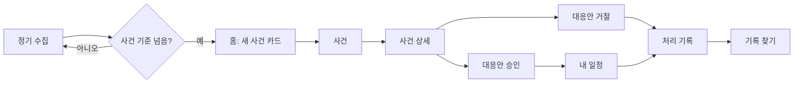

# IA: HomeFit AI

- 근거: [docs/문제정의.md](문제정의.md)(승인), [ADR 0003](adr/0003-기획안-기능은-PRD-범위로.md)(기능 우선순위), [평가항목](프로젝트3-평가항목.md) B절, 기획안 9절 화면 구성
- 작성일 / 버전: 2026-11-17 / v1.3 (v1.1 승인 2026-11-17. v1.2: 맞는 공고 상세, v1.3: 공고 팔로우 승인·거절·공고 요약. H-006 사용자 의견 2026-11-17)
- 범위: 신규 구축 (웹, Next.js App Router)
- Depth 한도: 핵심 목표(사건 알림 → 대응안 승인)까지 홈에서 3 Depth
- 엑셀: [IA.xlsx](IA.xlsx)(작성가이드, IA, 메뉴구조도, 화면목록 시트). 원본 자료는 [IA-screens.json](IA-screens.json)이고, 화면을 고치면 JSON을 고친 뒤 아래 명령으로 다시 만든다.
  `py -3 -X utf8 .claude/skills/harness-ia/scripts/build_ia_workbook.py docs/IA-screens.json docs/IA.xlsx`
- 우선순위: MVP = 꼭(Must), 2차 = 해야 함(Should), 보류 = 되면 함(Could). 만드는 순서는 plan에서 정한다.

## 확인된 사항
| 항목 | 답 | 반영한 곳 |
|---|---|---|
| 만들 문서 | IA + 화면목록 + 메뉴구조도 + 엑셀 | 이 문서, IA.xlsx |
| 첫 화면 | 로그인 뒤 홈 대시보드(벤토 카드) | HM_000000_PG |
| 사용자 메뉴 | 홈, 사건, 내 정보, 집 비교, 기록 찾기, 내 일정 | 네비게이션 모델 |
| 관리자 진입 | `/admin` 따로 | AD_070000_PG |
| 알림을 어디로 보내나 | 앱 안 표시(홈 카드, 사건 목록의 새 표시) + 사용자가 켠 경우 본인 슬랙으로 알림 (사용자 결정 2026-11-17) | HM, IC, MY_030500_TB |
| 처음 보이는 맞는 공고 | 사건이 아니라 맞는 공고 목록에 보인다. 공고에 변화가 생기면 사건 (사용자 결정 2026-11-17) | NT_080000_PG, IC |
| 사건 종류 | 청년 주거 지원 공고·정책, 습도·결로 위험, 주변 전월세 시세 변화(내 집 / 관심 지역) | 문제정의 사건 기준 표 |

## 메뉴구조도
범례: 🟢 신규 (전부 신규 구축이라 모든 메뉴가 신규다)

- 로그인
  - 회원가입
  - 비밀번호 재설정 (2차)
- 홈
  - 사건
  - 맞는 공고
  - 내 정보
    - 공고·정책 조건
    - 내 집
    - 관심 지역
    - 계정
    - 알림
  - 집 비교 (2차)
    - 관심 주택 등록
    - 실질 주거비 비교
  - 기록 찾기
  - 내 일정
- 관리자
  - 회원
  - 수집 현황
  - 사건 현황
  - 흐름 화면
  - 시뮬레이터
  - 채점 결과
  - 위키 챗봇

## IA 표
| 화면 ID | 0 Depth | 1 Depth | 2 Depth | 3 Depth | 화면명 | 형태 | 로그인 | 개발 구분 | 우선순위 | URL | 비고 |
|---|---|---|---|---|---|---|---|---|---|---|---|
| HM_000000_PG | 홈 | | | | 홈 | 페이지 | 필요 | 개발 | MVP | / | 벤토 카드. 숫자를 누르면 해당 목록 (P3-12). 근거: 지금의 답 |
| MB_010000_PG | 로그인 | | | | 로그인 | 페이지 | 불필요 | 개발 | MVP | /login | P3-07 |
| MB_010100_PG | 로그인 | 회원가입 | | | 회원가입 | 페이지 | 불필요 | 개발 | MVP | /signup | |
| MB_010200_PG | 로그인 | 첫 설정 | | | 첫 설정 | 페이지 | 필요 | 개발 | MVP | /onboarding | 가입 직후 1회, 공고·정책 조건 입력. 근거: 걸림돌(C) |
| MB_010300_PG | 로그인 | 비밀번호 재설정 | | | 비밀번호 재설정 | 페이지 | 불필요 | 외부연동 | 2차 | /reset-password | Supabase Auth 메일 |
| IC_020000_PG | 홈 | 사건 | | | 사건 | 페이지 | 필요 | 개발 | MVP | /incidents | 종류·상태·기간 거르기, "데이터 없음"과 "조회 실패" 구분 (P3-03, P3-12) |
| IC_020100_PG | 홈 | 사건 | 사건 상세 | | 사건 상세 | 페이지 | 필요 | 개발 | MVP | /incidents/[id] | 바뀐 것과 출처, AI 요약·대응안 초안, 비슷한 지난 사건 (P3-05, P3-18) |
| IC_020101_MD | 홈 | 사건 | 사건 상세 | 대응안 승인 | 대응안 승인 | 모달 | 필요 | 개발 | MVP | | 승인하면 내 일정에 저장 (P3-04) |
| IC_020102_MD | 홈 | 사건 | 사건 상세 | 대응안 거절 | 대응안 거절 | 모달 | 필요 | 개발 | MVP | | 사유 필수, 기존 값 유지 (P3-04) |
| MY_030000_PG | 홈 | 내 정보 | | | 내 정보 | 페이지 | 필요 | 개발 | MVP | /my | |
| MY_030100_TB | 홈 | 내 정보 | 공고·정책 조건 | | 공고·정책 조건 | 탭 | 필요 | 개발 | MVP | /my/conditions | 지역·공급 유형·임대료 상한·나이 (P3-10, P3-11) |
| MY_030200_TB | 홈 | 내 정보 | 내 집 | | 내 집 | 탭 | 필요 | 개발 | MVP | /my/home | 시군구·유형·면적·계약·만료일·창 종류 |
| MY_030201_MD | 홈 | 내 정보 | 내 집 | 실내 온습도 입력 | 실내 온습도 입력 | 모달 | 필요 | 개발 | MVP | | 측정값, 작성자·측정 시각, 범위 밖 값 막음 (P3-10) |
| MY_030202_PG | 홈 | 내 정보 | 내 집 | 하자 기록 | 하자 기록 | 페이지 | 필요 | 개발 | 2차 | /my/home/defects | 누수·곰팡이·고장 기록과 사진 |
| MY_030300_TB | 홈 | 내 정보 | 관심 지역 | | 관심 지역 | 탭 | 필요 | 개발 | MVP | /my/areas | 시세(관심 지역) 사건 기준 |
| MY_030400_TB | 홈 | 내 정보 | 계정 | | 계정 | 탭 | 필요 | 개발 | MVP | /my/account | 로그아웃, 탈퇴 |
| MY_030500_TB | 홈 | 내 정보 | 알림 | | 알림 | 탭 | 필요 | 개발 | MVP | /my/notifications | 팀 슬랙 이메일(기본값 로그인 이메일), 알림 켜기·끄기, 시험 메시지 보내기. 켜는 것이 알림 승인 (사용자 결정 2026-11-17) |
| CP_040000_PG | 홈 | 집 비교 | | | 집 비교 | 페이지 | 필요 | 개발 | 2차 | /compare | 관심 주택 목록 |
| CP_040100_PG | 홈 | 집 비교 | 관심 주택 등록 | | 관심 주택 등록 | 페이지 | 필요 | 개발 | 2차 | /compare/new | 관리비 포함 항목까지 입력 |
| CP_040200_PG | 홈 | 집 비교 | 실질 주거비 비교 | | 실질 주거비 비교 | 페이지 | 필요 | 개발 | 2차 | /compare/cost | 알파 (P3-09) |
| CP_040300_PG | 홈 | 집 비교 | 관심 주택 상세 | | 관심 주택 상세 | 페이지 | 필요 | 개발 | 2차 | /compare/[id] | |
| CP_040301_TB | 홈 | 집 비교 | 관심 주택 상세 | 입주 전 점검 | 입주 전 점검 | 탭 | 필요 | 개발 | 2차 | /compare/[id]/check | Housing QC 체크리스트 |
| CP_040302_TB | 홈 | 집 비교 | 관심 주택 상세 | 출퇴근 정보 | 출퇴근 정보 | 탭 | 필요 | 외부연동 | 보류 | /compare/[id]/commute | |
| CP_040303_TB | 홈 | 집 비교 | 관심 주택 상세 | 건축물 정보 | 건축물 정보 | 탭 | 필요 | 외부연동 | 보류 | /compare/[id]/building | 건축HUB |
| KN_050000_PG | 홈 | 기록 찾기 | | | 기록 찾기 | 페이지 | 필요 | 개발 | MVP | /knowledge | RAG, 답마다 출처 사건 (P3-05, P3-18) |
| SC_060000_PG | 홈 | 내 일정 | | | 내 일정 | 페이지 | 필요 | 개발 | MVP | /schedule | 승인한 계획. 계약 만료 일정은 2차 |
| NT_080000_PG | 홈 | 맞는 공고 | | | 맞는 공고 | 페이지 | 필요 | 개발 | MVP | /notices | 내 조건에 맞는 공고 목록(사건 아님, 승인 없음). 제목·공급 유형·마감·원문 링크. 근거: 사건 정의 변경 2026-11-17 |
| NT_080100_PG | 홈 | 맞는 공고 | 공고 상세 | | 공고 상세 | 페이지 | 필요 | 개발 | MVP | /notices/[id] | 공고 원문 값, 단지별 지역·임대료, 원문 링크, 이 공고로 생긴 내 사건 링크. AI 공고 요약(처음 열 때 한 번), 팔로우 승인·거절(관심 없음) (H-006) |
| NT_080101_MD | 홈 | 맞는 공고 | 공고 상세 | 공고 거절 | 공고 거절 | 모달 | 필요 | 개발 | MVP | | 관심 없음, 사유 선택 (H-006) |
| SC_060100_PG | 홈 | 내 일정 | 일정 상세 | | 일정 상세 | 페이지 | 필요 | 개발 | MVP | /schedule/[id] | 체크리스트, 출처 사건 링크 |
| AD_070000_PG | 관리자 | | | | 관리자 | 페이지 | 필요 | 개발 | MVP | /admin | 관리자만, 화면·서버·RLS 모두에서 막음 (P3-13, P3-14) |
| AD_070100_TB | 관리자 | 회원 | | | 회원 | 탭 | 필요 | 개발 | MVP | /admin/users | |
| AD_070101_PG | 관리자 | 회원 | 회원 상세 | | 회원 상세 | 페이지 | 필요 | 개발 | MVP | /admin/users/[id] | 회원별 입력·수집 자료·사건·실패 |
| AD_070102_MD | 관리자 | 회원 | 관리자 수정 | | 관리자 수정 | 모달 | 필요 | 개발 | MVP | | 담당자·시각·사유 기록 (P3-13) |
| AD_070200_TB | 관리자 | 수집 현황 | | | 수집 현황 | 탭 | 필요 | 개발 | MVP | /admin/watch | 실행 기록, 연속 실패, "지금 한 번 실행" (P3-02, P3-17) |
| AD_070201_PG | 관리자 | 수집 현황 | 수집 실행 상세 | | 수집 실행 상세 | 페이지 | 필요 | 개발 | MVP | /admin/watch/[runId] | 오류 메시지의 키는 가림 |
| AD_070300_TB | 관리자 | 사건 현황 | | | 사건 현황 | 탭 | 필요 | 개발 | MVP | /admin/incidents | 관리자도 대신 승인 못 함 |
| AD_070400_TB | 관리자 | 흐름 화면 | | | 흐름 화면 | 탭 | 필요 | 개발 | MVP | /admin/flow | runs·run_steps (P3-08) |
| AD_070401_MD | 관리자 | 흐름 화면 | 상자 상세 | | 상자 상세 | 모달 | 필요 | 개발 | MVP | | 키 가림 (P3-08) |
| AD_070500_TB | 관리자 | 시뮬레이터 | | | 시뮬레이터 | 탭 | 필요 | 개발 | MVP | /admin/sim | 가짜 자료로 전체 흐름 시연 (P3-06) |
| AD_070600_TB | 관리자 | 채점 결과 | | | 채점 결과 | 탭 | 필요 | 개발 | MVP | /admin/eval | 맞힌·놓친·잘못 울린 수 (P3-06) |
| AD_070700_TB | 관리자 | 위키 챗봇 | | | 위키 챗봇 | 탭 | 필요 | 개발 | MVP | /admin/chat | P3-21 |

화면 38개: MVP 29개, 2차 7개, 보류 2개. 화면목록(No, ID, Location, 구현 상태)은 [IA.xlsx](IA.xlsx)의 "화면목록" 시트에 있다.

## 핵심 흐름

## 네비게이션 모델
- **주 네비게이션**: 데스크톱은 왼쪽 사이드바, 휴대폰은 아래 탭 5개(홈, 사건, 내 일정, 기록 찾기, 더 보기). 집 비교와 내 정보는 "더 보기" 안에 둔다.
- **보조 네비게이션**: 내 정보와 관리자는 위쪽 탭.
- **유틸리티**: 오른쪽 위 계정 메뉴(로그아웃). 관리자 권한이 있으면 "관리자" 링크가 보인다.
- **새 사건 표시**: 사이드바·아래 탭의 "사건"에 숫자 배지. 색만 쓰지 않고 숫자를 함께 쓴다.

## 화면별 콘텐츠 우선순위
### 홈
1. 승인 대기 사건 수와 가장 급한 사건 하나: 승인까지 가는 길이 가장 짧아야 한다.
2. 새 사건 수(종류별): 공고·정책 / 습도·결로 / 시세. 맞는 공고 수(사건과 따로)
3. 내 집 습도 요약(마지막 측정 시각 포함)과 다가오는 일정
4. 이번 달 실질 주거비(2차)
5. 조건이나 내 집이 비어 있으면 "입력해 주세요" 카드를 1번 자리에 둔다.

### 사건 상세
1. 무엇이 바뀌었나: 수집 값, 바뀐 정도, 출처, 수집 시각. 측정값과 추정값을 나눠 표시한다.
2. 대응안 초안과 승인·거절 버튼
3. 비슷한 지난 사건(RAG)과 출처
4. 처리 이력

## 유저 플로우
### 가입과 첫 설정
1. 로그인 → 회원가입 → 첫 설정에서 공고·정책 조건을 입력한다.
2. 내 집이 있으면 내 집 정보를 입력하고, 없으면 관심 지역을 고른다.
3. 홈으로 간다. 입력을 건너뛰었으면 홈 맨 위에 입력 카드가 보인다.

### 청년 주거 지원 공고·정책 사건 (첫 기능)
1. 하루 1번 수집에서 조건에 맞는 새 공고는 맞는 공고 목록에 들어간다. 이미 본 공고의 기간·임대료·공급 유형이 바뀌거나 같은 단지에 완화·추가모집·재공고가 올라오면 사건이 생기고, 슬랙 알림을 켠 사용자에게 알림이 간다.
2. 홈의 새 사건 카드나 사건 목록에서 사건 상세로 들어간다.
3. 신청 준비 계획 초안을 본다.
   - 승인하면 내 일정에 저장된다.
   - 거절하면 사유를 입력하고, 일정은 바뀌지 않는다.
4. 처리 기록이 남고, 기록 찾기에서 찾을 수 있다.

### 습도·결로 위험 사건
1. 내 집에서 실내 온습도를 입력한다(측정값).
2. 하루 2번 예보 수집 뒤 기준을 넘으면 사건이 생긴다. 측정값이 없으면 사건이 생기지 않고, 홈에 "온습도를 입력해 주세요"가 뜬다.
3. 대응 계획을 승인하거나 거절한다.

### 관리자 시연
1. 관리자 → 시뮬레이터에서 가짜 자료를 넣는다.
2. 흐름 화면에서 수집 → 사건 → 승인 대기 상자를 확인한다.
3. 사용자 계정으로 승인한 뒤 채점 결과를 본다.

## 용어 정의 (UI 표기)
| 개념 | UI 표기 | 비고 |
|---|---|---|
| 사건 | 사건 | "알림", "이벤트"로 쓰지 않는다 (GLOSSARY) |
| 맞는 공고 | 맞는 공고 | 사건과 섞지 않는다. "추천"이라 쓰지 않는다 |
| 알림 | 알림 | 슬랙으로 보내는 메시지만 가리킨다 |
| 대응안 승인·거절 | 승인 / 거절 | 버튼 이름 |
| 신청 준비 계획, 대응 계획, 재계약 판단 메모 | 그대로 | 내 일정의 항목 종류 |
| 측정값 / 추정값 | 측정값 / 추정값 | 한 화면에 같이 나오면 꼭 나눠 쓴다 |
| 관심 주택 / 관심 지역 / 내 집 | 그대로 | 셋을 섞지 않는다 |
| 수집 오류 | 수집 오류 | "변화 없음"과 다르다 |

## 공통 컴포넌트
| 컴포넌트 | 사용 화면 | 차이점 |
|---|---|---|
| 사건 카드 | 홈, 사건, 관리자 사건 현황 | 관리자에는 회원 이름 대신 회원 ID |
| 상태 배지(새 사건, 승인 대기, 승인, 거절, 수집 오류) | 사건, 내 일정, 수집 현황 | 색과 글자를 함께 표시 |
| 출처 표시 | 사건 상세, 기록 찾기, 위키 챗봇 | 수집 자료 / 지난 사건 / 위키 쪽 |
| 빈 화면 · 불러오는 중 · 조회 실패 | 모든 목록 | "데이터 없음"과 "조회 실패"를 다른 문구로 |

## 콘텐츠 증가 대응
- 사건, 처리 기록, 수집 실행 기록이 계속 늘어난다. 기간·종류·상태 거르기와 페이지 나누기(한 번에 20개)를 쓴다.
- 기록 찾기는 검색(RAG)으로 찾는다.

## URL 전략
- 패턴: `/섹션/하위/[id]`. Next.js App Router 폴더 이름과 같다.
- 거르기는 쿼리로 둔다(`/incidents?type=policy&status=pending&from=2026-11-01`). 새로고침해도 유지된다.
- 관리자는 모두 `/admin` 아래에 둔다.

## 다음 단계
- 승인되면 사용자 여정(`harness-journeys`)에서 "가입 → 첫 설정 → 공고·정책 사건 승인"을 핵심 여정으로 쓴다.
- 알림은 앱 안 표시 + 슬랙으로 정했다(2026-11-17). 보내는 방식은 PRD·ERD에서 정한다.
