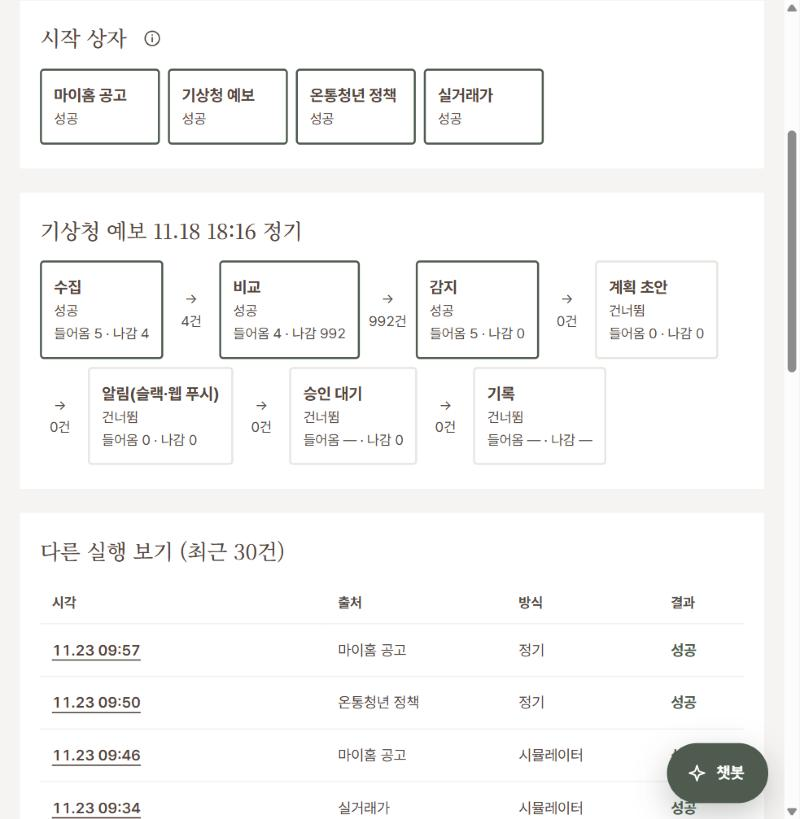
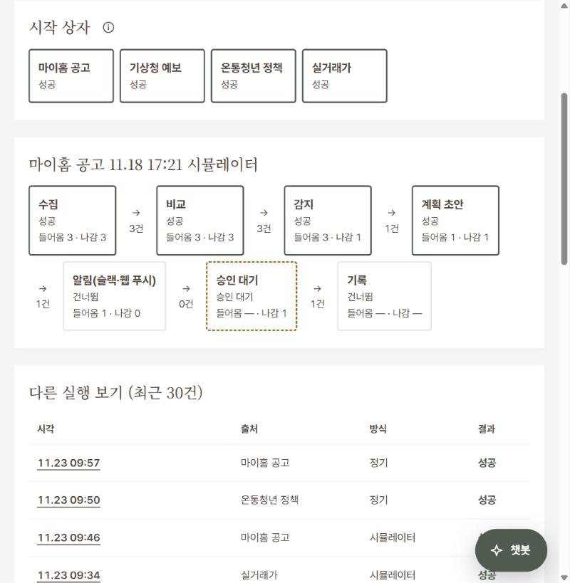
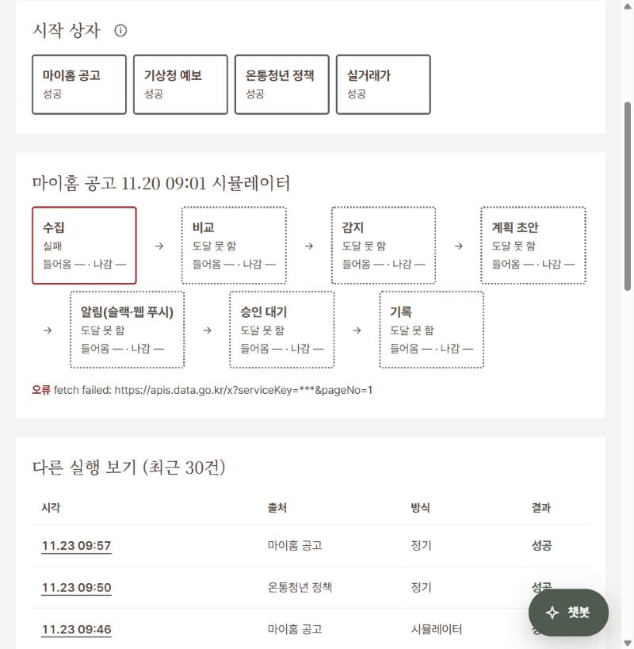
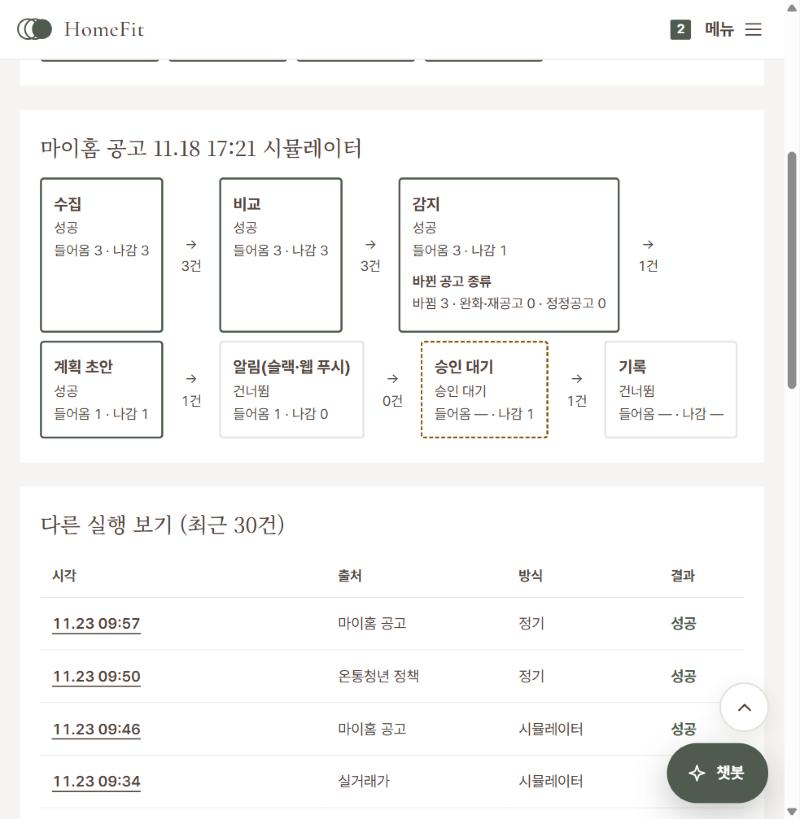

# 흐름 화면

- 상태: **초안 v0.5** (글과 화면 캡처 4장. 캡처는 2026-11-23 PR #47 새 디자인 운영 화면에서 다시 찍음. 안내서와 다른 점은 팀 결정 대기, 6절)
- 출처: 안내서 2절 "흐름 화면"·12절 제출 목록, 평가항목 P3-08, `docs/specs/005-관리자-시연-기록찾기/spec.md` FR-003
- 기준일: 2026-11-19 (글은 main `1ec8b1f`·PR #16까지). 알림 단계는 PR #44(2026-11-20), 캡처와 5.5절은 PR #47 새 디자인 운영 화면(2026-11-23)에 맞췄다. 이 문서는 **코드와 캡처에서 확인한 것만** 적는다. 화면은 5절 네 장면을 운영에서 관리자 가상 계정으로 열어 보고 감지 상자 하나를 눌러 본 것까지다.
- 코드 위치: 흐름 정의·해석 `flow/graph.ts`, 화면 `app/(main)/admin/flow/`, 실행 기록 쓰기 `watch/run-log.server.ts`, 수집 `watch/collect*.server.ts`

## 1. 한눈에
- 화면: 관리자 메뉴 > **흐름 화면** (`/admin/flow`). 배포한 서비스 안의 관리자 탭이고, 관리자만 볼 수 있다.
- 미리 그린 그림이 아니다. 수집이 돌 때마다 남기는 **실행 기록**(`runs` 한 줄, `run_steps` 단계마다 한 줄)을 읽어 상자와 화살표를 그린다. 기록이 없으면 상자가 켜지지 않는다.
- 화면은 세 부분이다.

| 부분 | 보이는 것 |
|---|---|
| 시작 상자 | 출처마다 하나씩 4개. 그 출처의 가장 최근 실행 상태(성공·실패·아직 안 켜짐) |
| 단계 흐름 | 고른 실행 하나의 단계 상자 7개와 화살표. 화살표 위에 넘어간 건수. 상자를 누르면 상세가 펼쳐짐 |
| 다른 실행 보기 | 최근 30건. 시각, 출처, 시작 방식(정기·손으로·시뮬레이터), 결과. 줄을 누르면 위 그림이 그 실행으로 바뀜 |

주소 뒤에 `?run=<실행 ID>`가 붙어 새로고침해도 같은 실행이 보인다. 수집 현황 화면(`/admin/watch`)과 시뮬레이터 결과에서 이 주소로 바로 넘어온다.

## 2. 상자 목록

### 2.1 시작 상자 (출처 4종)
`flow/graph.ts`의 `SOURCES`에 적힌 순서대로 그린다. 목록에 출처를 하나 더하면 시작 상자도 하나 더 생긴다.

| 시작 상자 | 출처 코드 | 수집 코드 | 정기 실행 (한국 시각) |
|---|---|---|---|
| 마이홈 공고 | `myhome_notice` | `watch/collect.server.ts` | 매일 09:00 |
| 기상청 예보 | `kma_forecast` | `watch/collect-weather.server.ts` | 매일 05:30, 17:30 |
| 온통청년 정책 | `youth_policy` | `watch/collect-youth.server.ts` | 매일 09:10 |
| 실거래가 | `rtms_trade` | `watch/collect-rent.server.ts` | 매월 2일 10:00 |

실행이 **무엇으로 시작됐는지**(정기 실행, "지금 한 번 실행" 버튼, 시뮬레이터)는 `runs.trigger`에 `scheduled`·`manual`·`simulation`으로 남고, 화면에는 고른 실행의 제목과 실행 목록에 "정기·손으로·시뮬레이터"로 보인다.

### 2.2 단계 상자 (7개, 이 순서)
`flow/graph.ts`의 `STEP_NAMES`와 `watch/run-log.server.ts`의 순서가 같다.

| # | 상자 | 기록 이름 | 종류 | 하는 일 |
|---|---|---|---|---|
| 1 | 수집 | `collect` | API 호출 | 출처 API를 읽어 우리 모양으로 바꾼다 |
| 2 | 비교 | `compare` | 변환·DB 저장 | 지난번에 본 값과 비교하고 새 값·바뀐 값을 저장한다 |
| 3 | 감지 | `detect` | 분기 | 사건 기준에 맞는지 판단해 사건을 만든다(같은 변화는 한 번만) |
| 4 | 계획 초안 | `draft_plan` | API 호출(AI) | 새 사건마다 대응 계획 초안을 만든다. AI가 실패하면 기본 체크리스트 |
| 5 | 알림(슬랙·웹 푸시) | `notify` | API 호출 | 알림을 켠 사람에게만 슬랙 DM을 보내고, 웹 푸시를 켠 기기에도 같은 글을 보낸다(PR #44, spec 021). 화면 상자 이름은 PR #44 전에는 "슬랙 알림"이었다 |
| 6 | 승인 대기 | `await_approval` | 사람 승인 | 사람이 승인·거절할 사건 수. 여기서 멈춘다 |
| 7 | 기록 | `record` | DB 저장 | 자리만 있다. 지금은 이 단계를 기록하는 코드가 없다(4절) |

### 2.3 상자 상태와 색
색과 함께 글자 라벨을 붙인다(`CLAUDE.md` 디자인 절).

| 상태 | 화면 글자 | 표시 | 언제 |
|---|---|---|---|
| `succeeded` | 성공 | 초록 실선 | 단계가 끝남 |
| `failed` | 실패 | 빨강 | 단계에서 멈춤 |
| `waiting` | 승인 대기 | 주황 점선 | 사람 승인을 기다리는 사건이 있음 |
| `running` | 실행 중 | 파랑 점선 | **시작 상자만.** 그 출처의 가장 최근 실행이 아직 돌고 있음(PR #16에서 추가). 단계 상자에는 나오지 않는다(6절 6번) |
| `skipped` | 건너뜀 | 회색 실선 | 할 일이 없었음(예: 새 사건 0건이면 계획 초안, 보낼 사람이 없으면 알림), 또는 그 출처가 쓰지 않는 단계 |
| `not_reached` | 도달 못 함 | 회색 점선, 흐린 글자 | 앞 단계가 실패해서 가지 못함 |
| `off` | 아직 안 켜짐 | 회색 점선, 흐린 글자 | 시작 상자만. 화면이 읽는 **최근 실행 30건** 안에 그 출처의 실행이 없음(기록이 한 번도 없다는 뜻이 아니다. 4절 아래 참고) |

## 3. 상자마다 들어오고 나가는 데이터
"들어옴·나감"은 `run_steps.items_in`·`items_out`에 남는 건수이고, 화살표 위 숫자는 앞 상자의 "나감"이다. 상세는 `run_steps.detail`(JSON)을 펼친 것이다.

### 3.1 마이홈 공고
| 상자 | 들어옴 | 나감 | 상세에 남는 것 |
|---|---|---|---|
| 수집 | API가 준 공고 줄 수 | 해석한 공고 수 | 건너뛴 줄, 겹친 줄 |
| 비교 | 공고 수 | 새 공고 + 바뀐 공고 | 새 것, 바뀐 것 수 |
| 감지 | 공고 수 | 새 사건 수 | 변화 종류별 수 |
| 계획 초안 | 새 사건 수 | 새 사건 수 | AI 공급자, AI 초안 수, AI 실패 수, 상한으로 건너뜀, AI 실패 이유 |
| 알림(슬랙·웹 푸시) | 새 사건 수 | 보낸 수(슬랙+웹 푸시) | 보냄, 실패, 다시 시도, 슬랙·웹 푸시 각각의 수, 지운 기기, 오류 |
| 승인 대기 | (없음) | 승인을 기다리는 사건 수 | (없음) |

### 3.2 기상청 예보
| 상자 | 들어옴 | 나감 | 상세에 남는 것 |
|---|---|---|---|
| 수집 | 내 집 수 | 예보를 읽은 시군구 수 | 예보 기준 시각, 실패한 시군구, 격자 모르는 시군구, 대표 격자로 대신함 |
| 비교 | 시군구 수 | 저장한 예보 값 수 | (없음) |
| 감지 | 내 집 수 | 새 알림 + 바뀐 알림 | 새 알림, 바뀐 알림, 위험 없음, 예보 없음, 같은 48시간 창(중복 막음), 측정값 없음·오래됨 |
| 계획 초안 | 새 알림 수 | 새 알림 수 | 마이홈과 같음 |
| 알림(슬랙·웹 푸시) | 새 알림 수 | 보낸 수 | 보냄, 실패 (PR #44부터 슬랙·웹 푸시 각각) |
| 승인 대기 | (없음) | 새 알림 + 바뀐 알림 | (없음) |

### 3.3 온통청년 정책
| 상자 | 들어옴 | 나감 | 상세에 남는 것 |
|---|---|---|---|
| 수집 | API가 준 정책 줄 수 | 해석한 정책 수 | 건너뛴 줄, 겹친 줄 |
| 비교 | 정책 수 | 새 정책 + 바뀐 정책 | 새 것, 바뀐 것 수 |
| 감지 | 정책 수 | 0 | **늘 건너뜀.** 이유: "정책 변화 알림은 아직 만들지 않음 (spec 006 Q1)" |

정책은 화면 목록으로만 보여 주고 사건을 만들지 않아서, 계획 초안부터 뒤 상자는 기록이 없고 "건너뜀"으로 보인다.

### 3.4 실거래가
| 상자 | 들어옴 | 나감 | 상세에 남는 것 |
|---|---|---|---|
| 수집 | 읽을 대상(시군구·주택 유형) 수 | 받은 거래 수 | 읽은 달, 성공한 대상, 실패한 대상과 이유 |
| 비교 | 거래 수 | 비교한 대상 수 | 거래가 충분한 대상, 거래가 부족한 대상 |
| 감지 | 비교한 대상 수 | 새 알림 수 | 만들려던 수, 만든 수, 관심 지역 값 갱신 수 |
| 계획 초안 | 새 알림 수 | 새 알림 수 | 마이홈과 같음 |
| 알림(슬랙·웹 푸시) | 새 알림 수 | 보낸 수 | 보냄, 실패 (PR #44부터 슬랙·웹 푸시 각각) |
| 승인 대기 | (없음) | 새 알림 수 | (없음) |

### 3.5 비밀 값 가리기
- 실행 기록에 쓰기 전에 오류 문구에서 키 값을 가린다(`watch/mask.ts`의 `maskSecrets`: 환경변수의 키 값, 주소 속 `serviceKey=` 뒤, 슬랙 토큰 모양).
- 화면에 그릴 때 한 번 더 가린다. 상세 항목 이름이 `key`·`token`·`secret`·`password`·`authorization`처럼 생기면 값을 통째로 `***`로 바꾼다(`flow/graph.ts`).
- 화면 쪽 가릴 목록(`app/(main)/admin/flow/page.tsx`의 `secrets()`)에 `YOUTH_POLICY_API_KEY`도 들어 있다(PR #16에서 추가). 온통청년 수집은 기록에 쓰기 전에도 이 키를 가리므로 이중으로 막힌다.

## 4. 실패했을 때
| 무슨 일 | 기록 | 화면 |
|---|---|---|
| 출처 API 읽기 실패, 응답 모양이 깨짐 | 실행은 `failed`, `collect` 단계가 `failed`이고 상세에 오류. `runs.error_message`에 이유(키는 가림) | 수집 상자가 빨강 "실패", 뒤 상자는 "도달 못 함", 그림 아래에 **오류** 문구 |
| 저장 실패 등 중간 단계에서 오류 | 실행 전체가 `failed`. 이미 끝난 단계 기록은 그대로 두고, 실패 기록을 **`collect` 이름으로** 한 줄 더 남긴다(실패한 실제 단계 이름이 아님) | 수집 상자가 빨강 "실패"로 보일 수 있고, 그 뒤에 이미 끝난 단계는 "성공", 기록이 없는 단계는 "도달 못 함"으로 보인다. 어느 단계에서 났는지는 그림 아래 오류 문구로 구분해야 한다(6절 4번) |
| 날씨에서 일부 시군구만 실패 | 실행은 계속. 실패한 곳은 수집 상세에 목록으로 | 수집 상자는 "성공", 상세에 "실패한 시군구"가 보임 |
| 시세(실거래가)에서 일부 시군구·유형만 실패 | 읽은 곳은 끝까지 판단하고 `collect` 단계도 `succeeded`. 다만 **실행 전체는 `failed`**로 끝나고 `runs.error_message`에 "시군구·유형 N곳을 읽지 못했습니다(나머지는 판단함)"가 남는다(`watch/collect-rent.server.ts`의 `collectRent`) | 수집 상자는 "성공"인데 **시작 상자(실거래가)는 "실패"**로 보이고 그림 아래에 오류 문구가 나온다. 일부만 실패해도 "변화 없음"으로 끝내지 않으려는 것이다 |
| 날씨·시세에서 전부 실패 | 실행 `failed` | 수집 상자 빨강 |
| 알림 실패 | 알림 단계 전체가 오류를 내거나, 슬랙·웹 푸시 중 한쪽이 오류를 내면 `notify`만 `failed`(다른 쪽은 그대로 보냄, PR #44). 사람별 DM 실패는 `notify`가 성공으로 남고 상세의 "실패" 수로 보인다. 어느 쪽이든 수집과 사건은 그대로 성공 | 알림 상자만 빨강이거나, 상세에 "실패" 수. 알림 실패가 수집을 실패시키지 않는다 |
| AI 초안 실패 | `draft_plan`은 성공으로 남고 상세에 AI 실패 수와 이유. 계획은 기본 체크리스트로 만들어짐 | 계획 초안 상자 상세에 "AI 실패", "AI 실패 이유" |
| 읽을 대상이 없음(내 집 0개 등) | `collect`가 `skipped`, 이유가 상세에 | 수집 상자 "건너뜀" |
| 화면이 기록을 못 읽음 | (기록과 무관) | "흐름 기록을 불러오지 못했습니다. 잠시 뒤 다시 열어 주세요." |

알아 둘 점 세 가지(예림님 확인, PR #13 리뷰. 코드에서도 확인했다).
- **시작 상자의 "아직 안 켜짐"**은 "기록이 한 번도 없음"이 아니라 "화면이 읽는 **최근 실행 30건** 안에 그 출처가 없음"이다. 한 달에 한 번 도는 실거래가는 다른 출처 실행이 30건 넘게 쌓이면 꺼진 것처럼 보일 수 있다.
- **같은 실행에 `collect` 줄이 둘**(성공 한 줄, 중간 단계 오류로 남긴 실패 한 줄)이면 두 줄의 순서 번호가 같아서, 수집 상자에 어느 쪽이 보일지 정해져 있지 않다.
- 알림 상세에는 "보냄", "실패"와 함께 **"다시 시도"** 수도 있다(지난번에 못 보낸 것을 이번에 다시 보낸 수). PR #44부터는 "슬랙"·"웹 푸시"로 나눈 수와 "지운 기기"(더 받을 수 없는 기기), "오류"도 한국어로 보인다(`flow/graph.ts` 이름표, 선우 PR #44 리뷰 반영).

읽기에 실패하면 "변화 없음"이 아니라 수집 오류로 남는다. 일부러 실패시켜 보려면 시뮬레이터에서 `failure`나 `malformed` 묶음을 돌린다(`docs/demo-order.md` 장면 5).

## 5. 화면 캡처
선우가 관리자 가상 계정으로 운영 화면에서 다시 찍었다(2026-11-23 오전, PR #47 새 디자인, 화면 폭 800픽셀). 5.1·5.2·5.4는 처음 캡처(2026-11-18)와 **같은 실행 기록**이고, 5.3은 2026-11-20 선우가 리허설로 돌린 마이홈 `failure` 실행으로 바꿨다(11-18 01:37 기상청 실패 실행은 화면의 "최근 30건" 밖으로 밀려나 고를 수 없었다). 이번 캡처를 위해 시뮬레이터를 새로 돌리지는 않았다. 키, 이메일, 실제 계정 정보는 보이지 않는다.

### 5.1 성공한 실행 (정기 실행)

기상청 예보 11.18 18:16 정기. 시작 상자 4개가 모두 "성공"이다. 수집(들어옴 5, 나감 4) → 비교(4 → 992) → 감지(5 → 0)까지 진한 실선이고, 새 알림이 0건이라 계획 초안·알림(슬랙·웹 푸시)·승인 대기는 옅은 실선 "건너뜀"이다. 화살표 위에 넘어간 건수(4건, 992건, 0건)가 보인다.

### 5.2 승인 대기에서 멈춘 모습 (시뮬레이터)

마이홈 공고 11.18 17:21 시뮬레이터. 수집(3 → 3) → 비교(3 → 3) → 감지(3 → 1) → 계획 초안(1 → 1)이 성공이고, 알림(슬랙·웹 푸시)은 보낼 사람이 없어 "건너뜀"(들어옴 1, 나감 0)이다. **승인 대기 상자가 주황 점선**으로 멈춰 있고 나감 1은 사람이 승인·거절할 사건 수다. 기록 상자는 "건너뜀"이다(6절 3번).

### 5.3 실패한 실행

마이홈 공고 11.20 09:01 시뮬레이터(`failure` 묶음). **수집 상자가 빨강 "실패"**이고 그림 아래에 오류 문구("fetch failed: https://apis.data.go.kr/x?serviceKey=***&pageNo=1")가 보인다. 오류 문구 속 **API 키가 `***`로 가려진 것**도 이 캡처에서 보인다. 뒤 상자 6개는 회색 점선 "도달 못 함"이다. 읽기 실패가 "변화 없음"이 아니라 수집 오류로 남는 모습이다.

### 5.4 상자를 펼친 상세

5.2와 같은 실행에서 감지 상자를 펼쳤다. 상세에 **"바뀐 공고 종류: 바뀜 3 · 완화·재공고 0 · 정정공고 0"**이 한국어로 보인다. 처음 캡처(PR #16 전)에는 `changes`, `{"changed":3,"relaxed":0,"correction":0}`처럼 영어·JSON 그대로였다. PR #16에서 이름표(`flow/graph.ts`의 `DETAIL_LABEL`)와 묶음 값 풀어 쓰기를 더한 결과다.

### 5.5 캡처에서 보이는 점
- 알림 상자 이름은 "알림(슬랙·웹 푸시)"이다(선우가 2026-11-20 PR #44 리뷰에서 바꾸자고 했고 `d184ed4`로 반영).
- PR #47 새 디자인에서 시각은 "11.18 18:16" 모양이고, 실행 목록 "다른 실행 보기(최근 30건)"는 표로 바뀌어 지금 보는 줄에 "보는 중"이 붙는다. 상자 설명 문장은 "시작 상자" 옆 ⓘ 안에 있다.
- 찍는 동안 마이홈 정기 수집이 돌아 시작 상자 "마이홈 공고"가 잠깐 점선 "**실행 중**"으로 보였다(2026-11-23 09:57). 그 장면은 캡처에 넣지 않았고, 끝난 뒤 다시 찍었다.
- 화면 폭 800픽셀에서는 단계 상자가 한 줄에 4개씩 두 줄로 놓이고, 위쪽 메뉴는 "메뉴" 단추 하나로 접힌다. 넓은 화면에서는 한 줄에 더 많이 놓인다.
- 상태별 선 모양을 화면에서 확인했다(PR #47 새 색): 성공은 진한 실선, 실패는 빨강, 승인 대기는 주황 점선, 건너뜀은 옅은 실선, 도달 못 함은 점선, 실행 중은 점선. 오른쪽 아래 "챗봇" 단추가 상자를 가리지 않게 화면을 조금 내려서 찍었다.
- 키 값이 가려진 오류 문구(`serviceKey=***`)는 5.3 캡처에서 보인다. 상자 상세의 가림은 코드(3.5절)와 qa 005 C-504로 확인된다.

## 6. 안내서 기준과 다른 점 (팀이 정해 주세요)
코드를 안내서 2절과 맞춰 본 결과 8곳이다. 틀렸다는 뜻이 아니라, 발표에서 질문이 나올 수 있는 곳이다.

**예림님 제안(PR #13 리뷰, 2026-11-18)**: 8곳은 고치지 않고 발표에서 설명으로 대신한다. 4번(호출 주소·응답 코드·걸린 시간)은 DB 구조를 바꿔야 해서다. 팀 전체가 정한 것은 아니다.

| # | 안내서 | 지금 구현 | 비고 |
|---|---|---|---|
| 1 | 시작 노드가 **시작 방식**(예약, "지금 실행" 버튼, 시뮬레이터)별로 보이고, 누른 것에서 출발한 길만 굵게 켜짐 | 시작 상자는 **출처**별 4개. 시작 방식은 실행 제목과 목록에 글자로 보임 | 시작 방식을 상자로도 보여 줄지 |
| 2 | 분기 노드에 갈래마다 건수("예 3건 / 아니오 9건") | 한 줄로 이어진 7단계. 감지 상자의 들어옴·나감으로 "사건이 된 수"만 보임 | "아니오" 갈래 건수는 들어옴 − 나감으로 계산할 수 있음 |
| 3 | 사람이 승인하면 **이어서 조치와 기록으로** 가는 것이 보임 | 승인·거절은 실행 기록을 바꾸지 않는다. `record` 단계를 기록하는 코드가 없어 "기록" 상자는 늘 건너뜀·도달 못 함이고, 승인 대기 상자도 승인 뒤에 그대로다 | 승인 결과는 사건·처리 이력 화면에서 봄. 흐름에도 이을지 |
| 4 | 상자를 열면 **호출 주소, 응답 코드, 걸린 시간** | `run_steps`에 주소·응답 코드 칸이 없고, 시작·끝 시각을 같은 값으로 써서 걸린 시간이 남지 않는다. 상세에는 건수와 오류만 있음. 중간 단계 오류도 `collect` 이름으로 기록됨 | 가장 큰 차이 |
| 5 | 실행 목록에 **걸린 시간과 처리한 건수** | 목록에는 시각, 출처, 시작 방식, 결과만 | `runs`에 시작·끝 시각은 있어 걸린 시간은 계산 가능 |
| 6 | 상자 상태에 "실행 중" | **시작 상자**에는 "실행 중"(파랑 점선)이 나온다(PR #16). **단계 상자**에는 없다. 실행 목록에는 "도는 중" | 단계 기록을 끝난 뒤에 쓰기 때문에 단계 상자는 돌고 있는 동안 비어 있다 |
| 7 | 노드와 연결을 **파일 하나**(예: `flow/flow.json`)에 | `flow/graph.ts`의 `STEP_NAMES`와 `SOURCES`가 그 역할. 출처를 더하면 시작 상자가 늘어남 | 이름만 다름. README에서 연결하면 됨 |
| 8 | (문서 사이) | spec 005 FR-003은 "시작 상자 3종"인데 코드는 4종(온통청년 포함) | spec 쪽을 맞추면 됨 |

## 7. 이 문서에서 확인하지 못한 것
- 화면은 5절 네 장면(성공, 승인 대기, 실패, 상세)만 운영에서 직접 열어 봤다(2026-11-19, PR #47 뒤 2026-11-23 다시). 2.3절 표의 색 이름(초록·회색)은 PR #47 전 기준이고, 새 디자인에서는 진한·옅은 선으로 보인다(5.5절). 2.3절의 상태 표시와 4절의 수집 실패 모습은 화면과 맞았다. 그 밖의 경우(일부 시군구 실패, 슬랙 알림 실패, 중간 단계 실패, 4절 아래 "알아 둘 점" 세 가지)는 코드로만 읽었다.
- 승인·거절 뒤 흐름 화면이 어떻게 보이는지(6절 3번은 코드에서 "실행 기록을 고치는 곳이 없다"는 것으로 판단).
- 색과 선 모양은 성공·실패·승인 대기·건너뜀·도달 못 함을 화면에서 확인했다(5.5절). "실행 중"(파랑 점선)과 "아직 안 켜짐"은 그 시각에 해당하는 실행이 없어 화면에서 보지 못했다.
